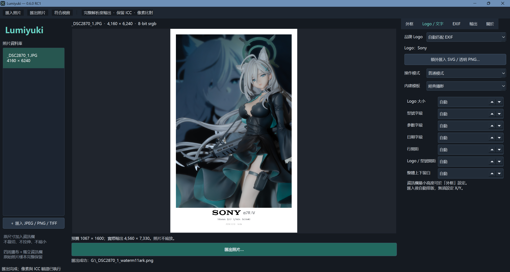

# Lumiyuki

### Photography, beautifully framed.

**让每一张照片，都拥有属于自己的精致落款。**

Lumiyuki 是由 **Yuki Studio** 开发的 Windows 桌面摄影水印工具，专注于为摄影作品添加简洁、优雅的相机信息水印。

---

## 📥 下载 Lumiyuki

**当前版本：v0.6.0 RC1（公开测试版）**

**[⬇️ 点击下载 Windows 安装包](https://github.com/YukiWaByakuya/Lumiyuki/releases/download/v0.6.0-rc1/Lumiyuki-Setup-0.6.0-rc1.exe)**

[查看版本更新与发布说明](https://github.com/YukiWaByakuya/Lumiyuki/releases)

> 当前为测试版本，安装包尚未进行数字签名，Windows 可能显示未知发布者提示。

---

## ✨ 主要功能

- **相机品牌水印**：支持 Sony、Hasselblad 等相机品牌标识
- **EXIF 信息读取**：自动提取相机型号、焦距、光圈、快门速度、ISO 等拍摄参数
- **精致边框排版**：支持四周留白与底部拍摄参数展示
- **自定义模板**：支持调整水印样式并保存个人模板
- **批量处理**：一次导入多张照片并批量导出
- **高质量输出**：支持 PNG / TIFF 和 8-bit / 16-bit 图像
- **色彩管理**：支持保留 ICC 色彩配置文件
- **原图保护**：在已验证的测试场景中，原图区域像素差异为 0

---

## 🖼️ 软件预览
### 软件界面

---

## 💻 安装方法

1. 下载上方的 Windows 安装包
2. 双击运行 `Lumiyuki-Setup-0.6.0-rc1.exe`
3. 根据安装向导完成安装
4. 启动 Lumiyuki，导入照片并制作水印

无需安装 Python 或其他开发环境。

---

## 🧪 当前版本说明

Lumiyuki v0.6.0 RC1 是首个公开测试版本，已完成主要功能、图像质量及安装流程的针对性测试。

目前尚未充分验证不同电脑配置下的兼容性，欢迎通过 [GitHub Issues](https://github.com/YukiWaByakuya/Lumiyuki/issues) 反馈问题。

---

## 💫 关于项目

**软件名称：** Lumiyuki  
**开发品牌：** Yuki Studio  
**作者：** 有希羽白夜☆  
**支持平台：** Windows  
**当前版本：** 0.6.0 RC1

© 2026 Yuki Studio. All rights reserved.

*Photography, beautifully framed.*
